# netmon

**Network monitor for home and small networks** – a PHP/MySQL web app that scans your LAN, shows every device in a
tree, list and room view, reads switches, access points and the router directly (ports, link speed, traffic, cable
test, Wi-Fi clients, DSL values) – and lets you **switch things**: lock switch ports, Wi-Fi on/off, LEDs off at night.
A **simple view** with an internet traffic light and big buttons is made for family members without any network know-how.

*Deutsch: [Kurzanleitung](LIESMICH.md) · [Handbuch](docs/HANDBUCH.md)*

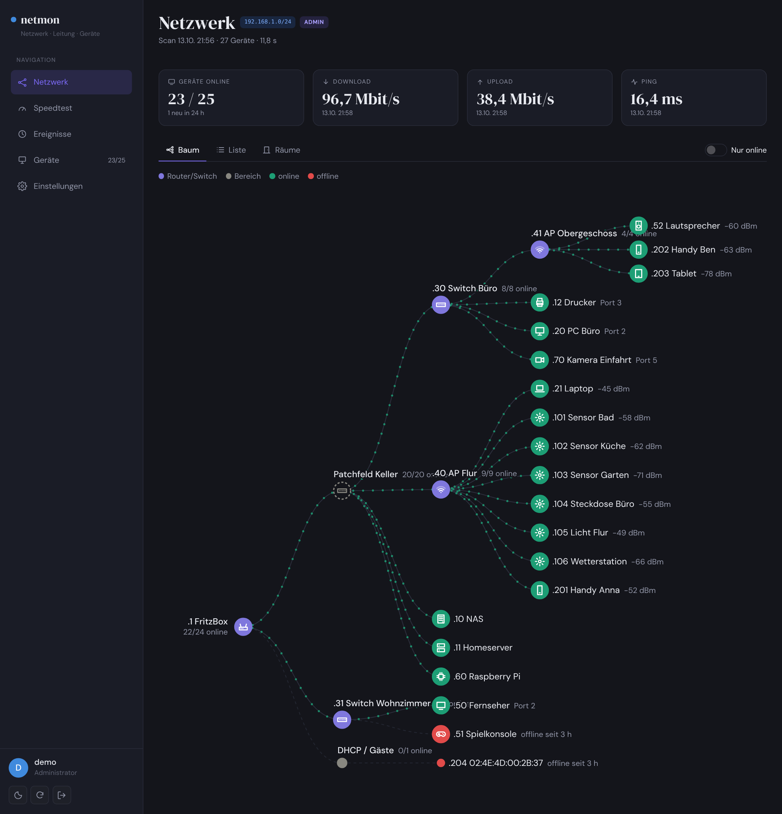

| Simple view (desktop) | Simple view (phone) – who loses the network? |
|---|---|
| 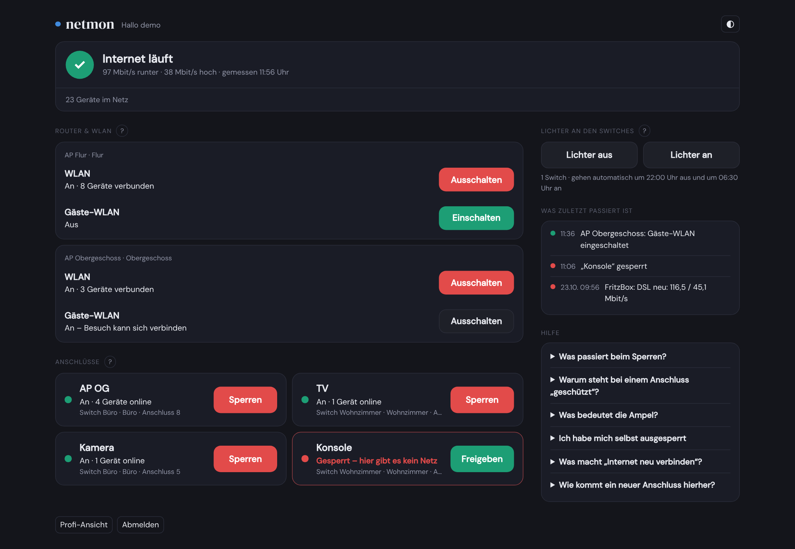 | 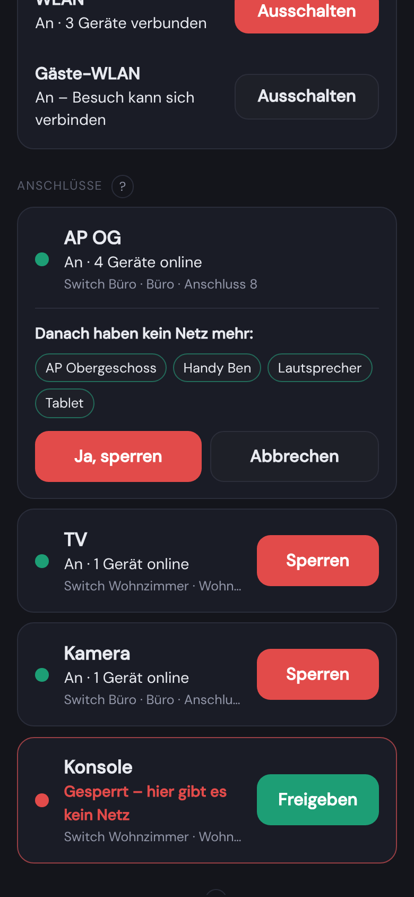 |

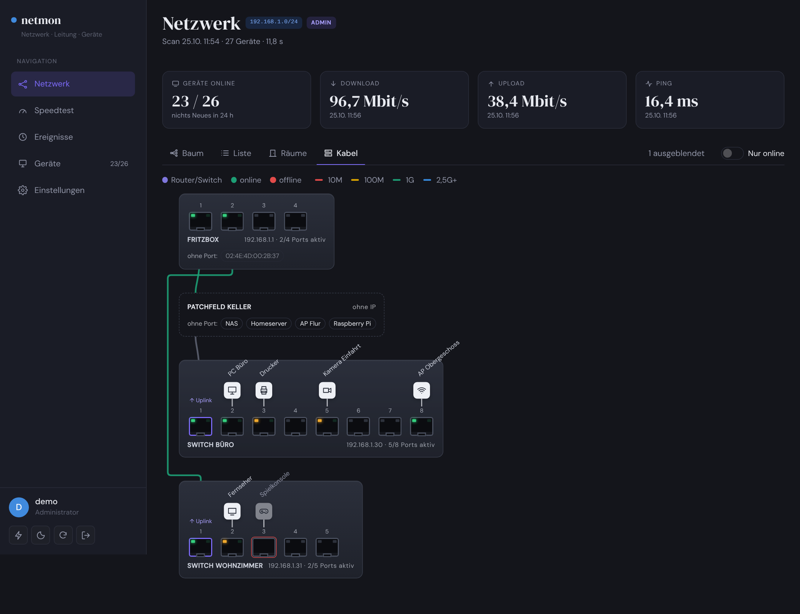

| Rooms | Switch ports | Port traffic |
|---|---|---|
| 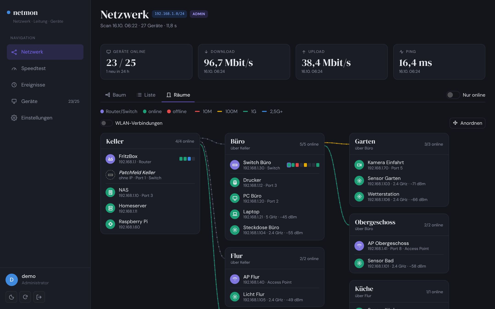 | 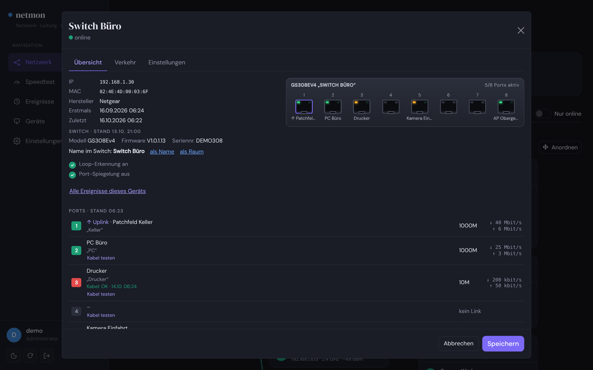 | 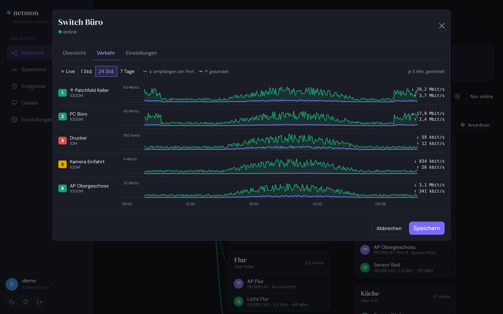 |
| **FritzBox DSL & internet** | **Access point / Wi-Fi clients** | **Speedtest** |
| 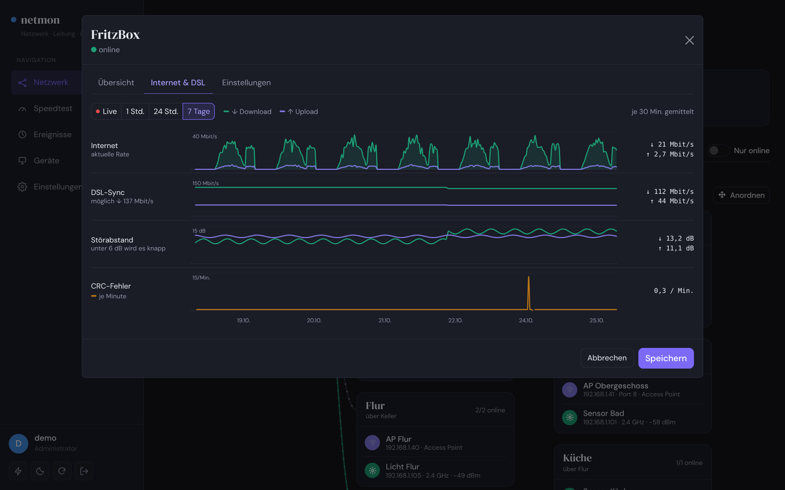 |  | 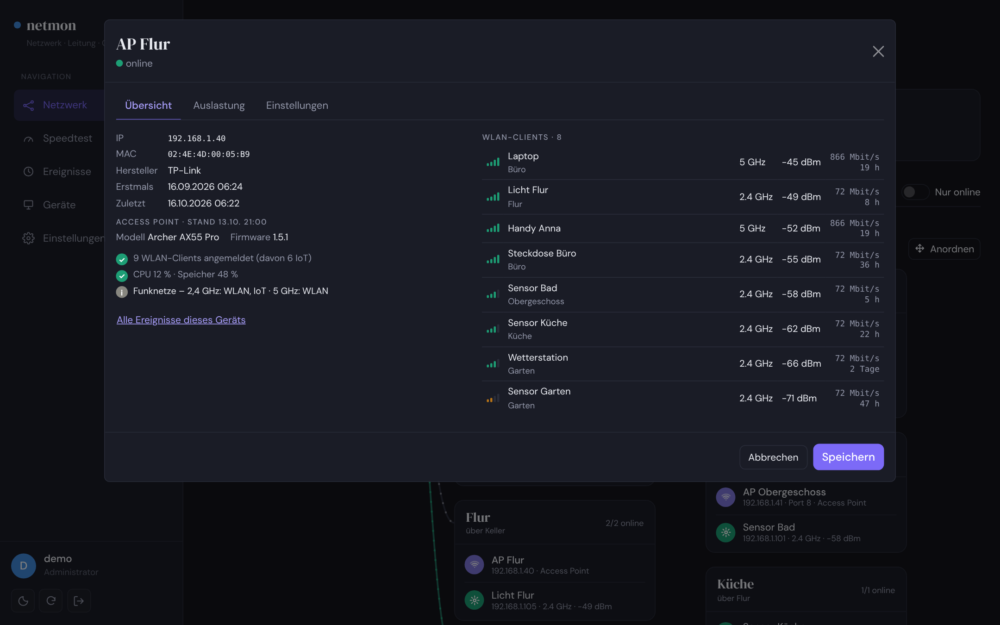 |
| **Light theme** | **Mobile** | |
| 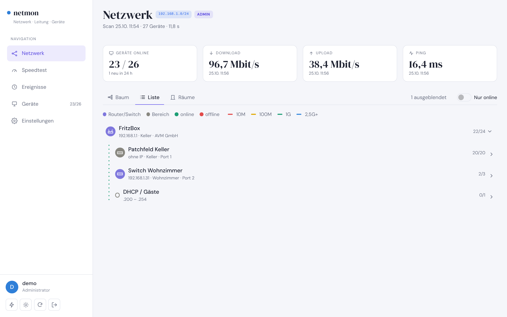 | 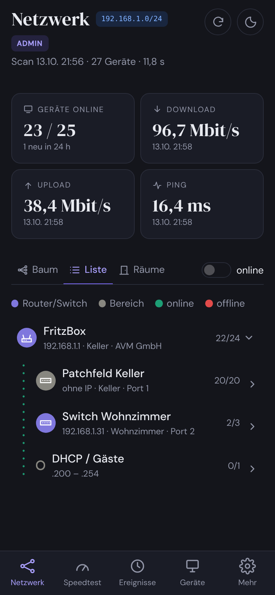 | |

*Screenshots show a demo network with made-up devices.*

## Features

- **Scan** with nmap: new devices, online/offline, IP changes as events; vendor from MAC; devices offline for a few
  days are hidden (kept in the database, shown again when they return)
- **Views:** tree (router → switches → devices, router Wi-Fi as its own branch), list, rooms with freely arrangeable
  cards and cable lines, and a **cabling view**: router and switches seen from the front, cables from port to port,
  devices above their jacks
- **Link speed in colour** on every cable: 10M red, 100M yellow, 1G green, 2.5G+ blue
- **Device drivers:**

  | Driver | Models | Reads | Controls | Status |
  |---|---|---|---|---|
  | Netgear Plus | GS105E v2, GS108E v3, GS305E, GS308E | ports, speed, traffic, CRC, checks | lock ports, cable test | in use |
  | Netgear Plus, new UI | GS308E v4, GS108E v4, GS30xEP | same | lock ports, LEDs, cable test | in use |
  | Netgear GS116E v2 / JGS | GS116Ev2, JGS516PE, JGS524Ev2 | ports, speed, traffic | lock ports | GS116Ev2 in use |
  | Netgear GS316EP / EPP | GS316EP, GS316EPP | ports, traffic, PoE sum | LEDs | tested against reference pages |
  | TP-Link Easy Smart | TL-SG105E/108E/116E … | ports, speed | – | draft |
  | TP-Link Archer / Deco | Archer AX55 Pro, Archer C80 … | Wi-Fi clients, CPU/memory | Wi-Fi / guest / IoT on/off, reboot | in use (needs Python) |
  | AVM FRITZ!Box / Repeater | 7590 and others, FRITZ!Repeater | DSL, SNR, CRC, internet rate, LAN, Wi-Fi clients (TR-064) | – | in use |
  | Telekom Speedport | Smart 3, Smart 4, Smart 4R | DSL, LAN ports, Wi-Fi clients – **no password needed** | with device password: Wi-Fi / guest on/off, reconnect, reboot | in use (Smart 4R) |

- Port front panel, traffic history (1 h / 24 h / 7 days) and **live view**, cable test, health checks
- **Lock / unlock switch ports** (e.g. the kids' access point), from the UI, the simple view or `collector/port.php`
  (cron). Uplinks and ports leading to another switch, the router or netmon itself are protected.
- **Switch LEDs off at night** on a schedule or via `collector/leds.php aus|an`
- **Simple view** for non-technical users: internet traffic light, "you are connected via …", router & Wi-Fi cards,
  pinned ports with big buttons; before locking it lists who will lose the network and warns if that includes you
- **Users and roles:** admin, family (view + lock/unlock + LEDs), viewer (read-only); each user starts in their own view
- **Repeaters with MAC masquerading** (e.g. FRITZ!Repeater on a third-party router) are detected automatically –
  the devices behind them get their own entries
- **Connection suggestions** from switch port descriptions and the FritzBox host list
- **Analysis package**: one click collects a device's web pages (no passwords) to build a driver for a new model
- **Remote access:** Tailscale subnet router (`--with-tailscale`) or from the internet with your own domain,
  Strato DynDNS and Let's Encrypt (`--with-internet`); login lock after repeated wrong passwords
- Dark/light theme, mobile friendly, installable as an app, all assets bundled locally (no CDN)

## Requirements

Debian/Ubuntu/Raspberry Pi OS (or any LAMP) with Apache, PHP ≥ 8.0 (pdo_mysql, curl, mbstring, xml), MariaDB/MySQL, nmap.
Optional: Python 3 venv with `tplinkrouterc6u` for TP-Link access points.

## Install

```bash
git clone https://github.com/theMagicKnight/netmon.git
cd netmon
sudo bash install.sh            # checks what is installed, adds the missing parts
# optional: --with-tailscale    remote access, home network offered as Tailscale subnet route
# optional: --with-internet     reachable from the internet: Strato DynDNS + HTTPS (Let's Encrypt)
```

The script checks Apache/PHP/MariaDB/nmap and the PHP extensions, installs only what is missing, copies the app to
`/var/www/html/netmon`, creates database + `config.php` (random password), sets up the cron job and prints the URL.
Running it again **updates** an existing installation – `config.php` and data are kept, the database schema is
upgraded automatically:

```bash
cd ~/netmon && git pull && sudo bash install.sh
```

Manual install (FTP + phpMyAdmin) and full documentation (German): see [docs/HANDBUCH.md](docs/HANDBUCH.md).

## Layout

```
netmon/            web app – everything in one folder (incl. config.php)
  index.php        full ("pro") view          schnell.php   simple view
  collector/       cron scripts (scan, speedtest, device polling, leds.php, port.php) – CLI only
  collector/drivers/  one file per device family, each names its sources in the header
sql/               schema and migrations
docs/              handbook (German) and screenshots
install.sh         installer / updater
```

## Adding a device

Open a device → *Settings* → choose a driver (or *auto-detect*) → password → *Connect & query*.
Unknown model? Click **Analysis package** and open an issue with the file (it contains no passwords).
For controls (locking ports, LEDs) a browser recording (HAR) helps – **log in first, then start recording**, so the
file contains no login data.

## Credits

- [py-netgear-plus](https://github.com/foxey/py-netgear-plus) (Apache-2.0) – reference for Netgear login/page layouts and test pages
- [hass_tplink_easy_smart](https://github.com/vmakeev/hass_tplink_easy_smart) (MIT) – reference for TP-Link Easy Smart
- [smrt](https://github.com/pklaus/smrt) / [philippechataignon-smrt](https://github.com/rgl/philippechataignon-smrt) (GPL) – protocol notes only, no code used
- [tplinkrouterc6u](https://github.com/AlexandrErohin/TP-Link-Archer-C6U) – used as library for TP-Link access points
- AVM [TR-064](https://avm.de/service/schnittstellen/) documentation
- [dsl-monitoring](https://github.com/aaronk6/dsl-monitoring) by aaronk6 – how to decrypt the Speedport `Status.json`
- [speedport-api](https://github.com/Andre0512/speedport-api) by Andre0512 (MIT) – reference for Speedport login and switching
- Bundled: Bootstrap 5.3 (MIT), D3 (ISC), Chart.js (MIT), DM Sans / DM Serif Display (SIL OFL 1.1)

No code was copied from the referenced projects; the drivers are written from scratch in PHP.

## License

[MIT](LICENSE)
